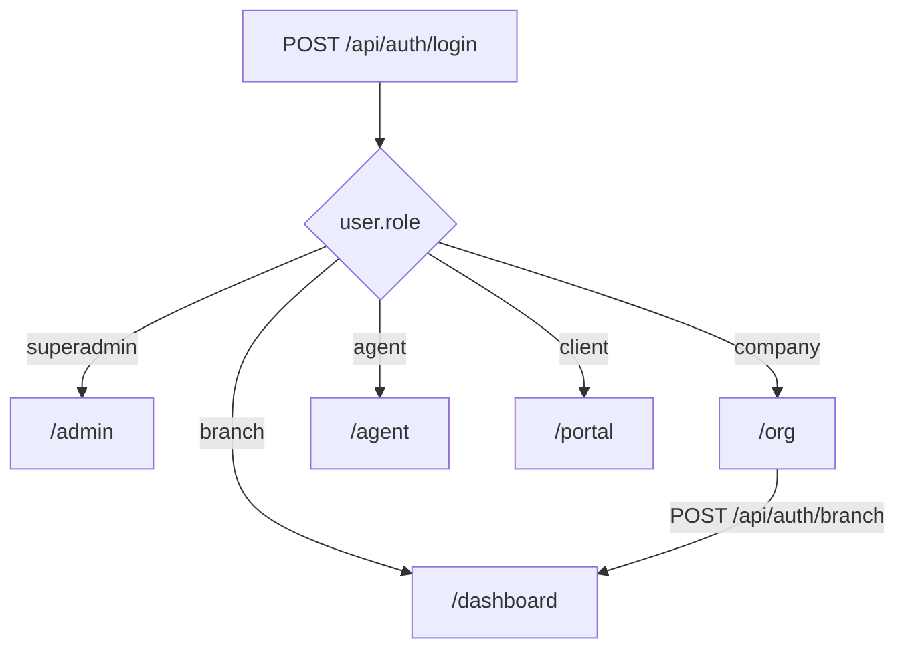
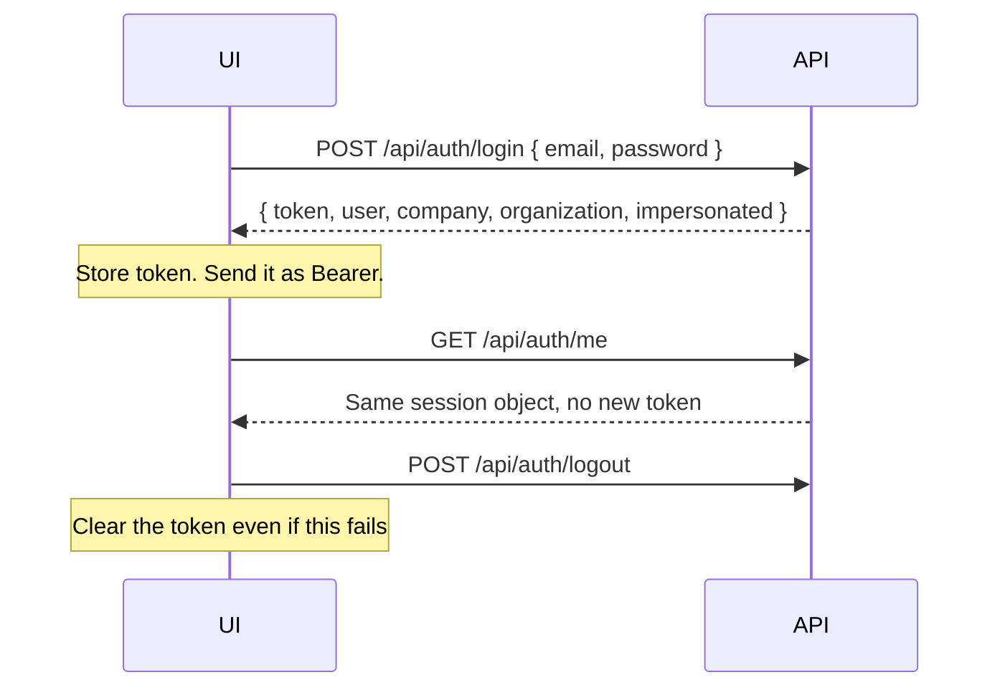
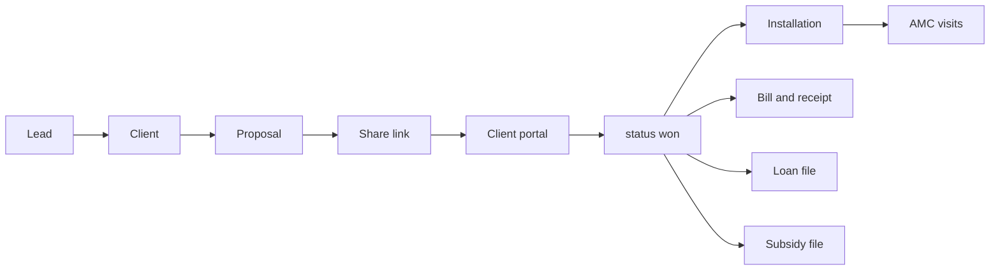
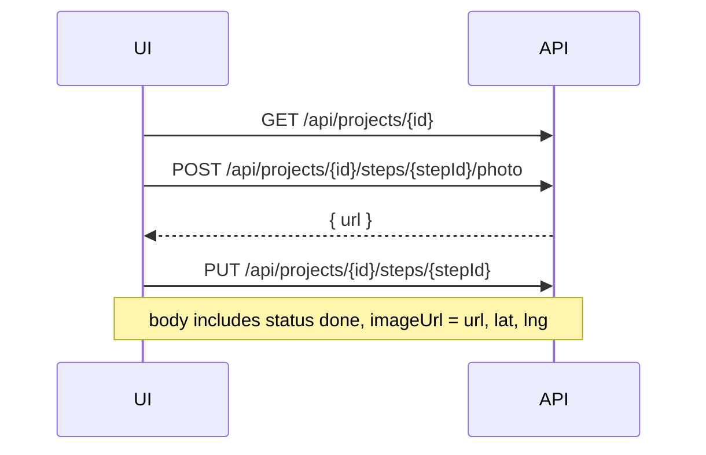
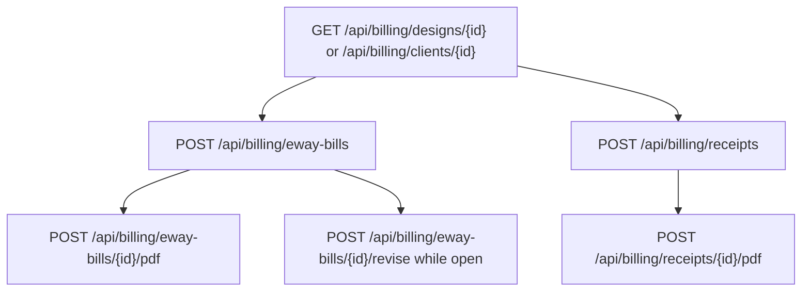
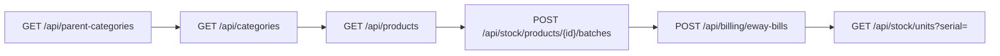

# Innovbit Solar — frontend flows

How the app moves, and which API to call at each step. Field-by-field payloads and responses are in Swagger: [http://localhost:4000/api/docs](http://localhost:4000/api/docs). This file is the order of calls. Swagger is the shape of each call.

Base URL in local development is `http://localhost:4000`. The frontend reads it from `NEXT_PUBLIC_API_URL` (`frontend/src/lib/api.js`).

## Rules that apply to every screen

- Send `Authorization: Bearer <token>` on every signed-in call. The token comes from `POST /api/auth/login`.
- Success JSON **is** the value. There is no `{ data: ... }` wrapper. A finished action with nothing to read returns `{ ok: true }`.
- Errors are `{ error, code?, details? }`. Show `error` to the user. `400` + `code: "VALIDATION"` puts per-field messages in `details.fields`. Some lead and Meta handlers return `{ message }` instead of `{ error }`; the app client already reads both.
- Extra JSON keys are ignored. Send only the fields that screen uses. On a partial update, omit a key to leave it unchanged.
- Ids are 24-character hex strings. A bad id is usually **404** with a noun (`Category not found`), not 400.
- A missing path is **404** `{ error: "Not found" }`.
- `401` means the token is missing or dead: clear it and go to login. `403` on a staff account means their role changed: call `GET /api/auth/me` again.
- Any successful write should refresh sidebar counts (`GET /api/dashboard/counts` for a branch owner or company admin, `GET /api/my/counts` for staff).
- The whole API allows 1500 requests per IP per 5 minutes. Stricter limits are named on the route in Swagger.

## Who signs in, and where they land

| `user.role` | Home | What they can call |
| --- | --- | --- |
| `superadmin` | `/admin` | `/api/admin/*` only. To open a company, impersonate (below). |
| `company` | `/org` | Organization, shared catalog, and masters. Day-to-day branch work needs a branch token. |
| `branch` | `/dashboard` | The branch workspace. Passes every staff permission check. |
| `agent` | `/agent` | Only areas in `user.permissions` (`area:action`, for example `proposals:view`). |
| `client` | `/portal` | `/api/portal/*` only. |

`company` is null and `organization` is null for a super admin. A company admin’s token always carries one active branch. `POST /api/auth/branch` with `{ branchId }` returns a **new** token; replace the stored token and call `GET /api/auth/me`.

A branch owner and a company admin skip staff permission checks. When the organization has branches, shared masters (catalog, step templates, branding) can be edited only by the company admin. A branch owner who tries gets **403** `Products and categories are shared by all branches. Only your company admin can change them.`

## Sign-in, session, sign-out

1. `POST /api/auth/login` with `{ email, password }`. Email is trimmed and lowercased. A wrong password and a company that cannot sign in both return **401** with the same message.
2. Save `token`. The rest of the body is the same shape as `GET /api/auth/me`.
3. On every page load, if a token is stored, call `GET /api/auth/me`. **401** means the session is gone: clear the token and show login.
4. `PUT /api/auth/me` changes only the display name. `POST /api/auth/password` changes the password and returns a **new** token; store that token.
5. `POST /api/auth/logout` revokes this device. No body.

One device at a time. A second login gets **403** `code: "DEVICE_LIMIT"`. Send `replaceSessions: true` only after the user confirms they want to sign the other device out. `replaceSessions` is not in the strict schema; send JSON `true` or `false`, not the string `"false"`.

### Super admin opening a company

1. `GET /api/admin/companies` on the admin console.
2. `POST /api/admin/companies/{id}/impersonate` with `{ who: "admin" }` (company dashboard) or `{ who: "owner" }` (branch dashboard).
3. Keep the super-admin token aside. Store the returned token as the working token. Impersonation does not revoke the admin token.
4. Leave the company: `POST /api/auth/logout` (ends the company session), put the admin token back, then `GET /api/auth/me`.

## The sale, from lead to a finished job

This is the path a branch workspace follows. Staff use the same APIs when their permissions allow it, except installations (see [Staff jobs](#staff-jobs)).

A proposal status is one of `draft`, `proposed`, `reproposed`, `negotiation`, `won`, `lost`. **Booked means `won`.** Billing, expenses-as-budget, and “start installation” all wait for `won`.

### 1. Lead arrives

Leads have three sources. There is no get-by-id. The list row is the detail, except Meta, which adds assignment history.

| Source | How it is created | List |
| --- | --- | --- |
| Manual | `POST /api/leads/manual` | `GET /api/leads/manual` |
| Spreadsheet | `GET /api/leads/manual/template`, then `POST /api/leads/manual/import` (multipart field `file`) | same manual list |
| Meta | Facebook calls `GET` and `POST /api/webhooks/meta`. The app does not call these. | `GET /api/leads/meta` |
| Google Ads | Google calls `POST /api/company/google-leads/webhook`. The app does not call this. | `GET /api/leads/google` |
| All sources | | `GET /api/leads/all` or `GET /api/leads/board` |

Before painting a board or a form:

- `GET /api/leads/statuses` — company status columns. Use these ids. Do not invent statuses.
- `GET /api/leads/form` — the company’s custom fields.
- `GET /api/leads/assignees` — only if the user may assign or view all.

Move a card: `PUT /api/leads/{source}/{id}/status` with `{ statusId }`. `source` is `meta`, `google`, or `manual`. Priority is only a boolean: `PUT /api/leads/{source}/{id}/priority` with `{ isPriority: true | false }`.

Assign: `POST /api/leads/{source}/assign`. Bulk: `GET /api/leads/{source}/unassigned-count` then `POST /api/leads/{source}/assign-unassigned`. `source` may also be `all` for the combined pair.

Staff without `leads:view_all` see leads they hold now, leads their team holds when they have `leads:view_team`, and leads they held before (those stay visible and are read-only). Unassigned leads are hidden from that scope.

`GET /api/leads/meta` accepts `from` and `to`, then does not apply them. `GET /api/leads/all` does apply received dates.

Connecting Meta or Google is a settings task, not a lead-list task. See [Lead sources](#lead-sources).

### 2. Lead becomes a client

Conversion does **not** create the client.

1. The lead must already sit on the status whose `outcome` is `"converted"`.
2. Open the client form prefilled from the lead. `POST /api/clients` creates the client.
3. Link them: `PUT /api/leads/{source}/{id}/converted` with `{ clientId }`.

`GET /api/clients` lists. `GET /api/clients/{id}` is the record. `GET /api/clients/{id}/overview` is the client page (proposals, tickets, and the rest that belong to them).

Give the client a portal login with `POST /api/clients/{id}/login`. Remove it with `DELETE /api/clients/{id}/login`. Upload a document with `POST /api/clients/upload-document` (multipart). The stored name is not public; see [Files](#files).

### 3. Proposal

`POST /api/designs` creates a draft. The request only requires `client` and `name`. The server also creates `shareToken` immediately.

Open the designer:

1. `GET /api/designs/{id}` — full proposal, including `data` (the 3D scene).
2. `GET /api/catalog` — categories, products, packages, and installation charges for the designer. This is read-only.
3. While the user edits, `PUT /api/designs/{id}` with `{ data, summary }`. This replaces `data` as a whole. The response is a short acknowledgement, not the proposal. Read it back with GET if you need the saved copy.
4. `GET /api/designs/{id}/lifecycle` for the timeline on the proposal page.

Other actions on that page:

| Action | Call |
| --- | --- |
| Change status (including Booked / `won`) | `PUT /api/designs/{id}` with `{ status }` |
| Duplicate | `POST /api/designs/{id}/duplicate` |
| Version list / save / restore | `GET` and `POST /api/designs/{id}/versions`, then `POST /api/designs/{id}/versions/{versionId}/restore` |
| Send for internal review | `POST /api/designs/{id}/send-for-review` |
| Copy the public link | `POST /api/designs/{id}/share` — **no body**. Returns `{ token }`. The page builds `/p/<token>`. |
| Turn the link off | `DELETE /api/designs/{id}/share` |
| Delete the draft | `DELETE /api/designs/{id}` |

Satellite and roof tools, used from the location step, cost money:

- `GET /api/staticmap/token` then `GET /api/staticmap` (the image may also take the token as a query).
- `GET /api/solar` and `GET /api/solar/model` — 40 per user per 10 minutes.
- `POST /api/roof-detect` — 15 per user per 10 minutes. Needs `proposals:update`.

Quick quotes that are not full proposals live under Estimation: `GET/POST /api/estimates`, `GET/PUT/DELETE /api/estimates/{id}`. `PUT` replaces the estimate; omitting lines sends an empty list and fails. `POST /api/estimates/{id}/converted` marks one as turned into a proposal.

Setting `loanRequired` or enabling a subsidy on the save does not have its own create route. The loan or subsidy file appears as a side effect of that save. Read it with `GET /api/loans/proposal/{designId}` or `GET /api/subsidies/proposal/{designId}`. **200 `null`** means there is no file yet, including when the id is not a proposal in this branch.

### 4. Client sees the proposal

Two doors, same proposal.

**Public link (no login).** Used by `/p/<token>`.

- `GET /api/public/proposals/{token}`
- `GET /api/public/proposals/{token}/design` — scene. Only `data.sections` is required to be non-empty; section contents are the designer document.
- `GET /api/public/proposals/{token}/catalog` — geometry with prices removed.
- `GET /api/public/staticmap` — ground image, authorised by the share token.

**Portal (client role).** Used after `POST /api/clients/{id}/login`.

- `GET /api/portal/me`
- `GET /api/portal/proposals` and `GET /api/portal/proposals/{id}`
- `GET /api/portal/proposals/{id}/design` and `GET /api/portal/catalog`
- Accept or decline: `POST /api/portal/proposals/{id}/response`
- Ask for an AMC visit later: `POST /api/portal/proposals/{id}/amc-requests`
- Their loan and subsidy, read-only: `GET /api/portal/loans`, `GET /api/portal/subsidies`
- Refer someone: `GET /api/portal/referrals/form`, `GET /api/portal/referrals`, `POST /api/portal/referrals`. This referral validation returns `details.errors` and no `code`.

`pricing` on a proposal is stored as-is. These read routes use `pricing.total` for the headline number. Do not expect a fixed pricing schema from these endpoints.

### 5. Booked: installation, loan, subsidy

After `status` is `won`:

**Start the job.** `POST /api/projects` with `{ design }` (the proposal id). One installation per proposal. The list is `GET /api/projects` and returns `{ items, total, page, limit }`.

**Loan and subsidy files** are not created here. They already exist if the proposal was saved with that flag. Open them from the proposal:

- `GET /api/loans/proposal/{designId}` or `GET /api/subsidies/proposal/{designId}`
- `GET /api/loans/{id}` and `GET /api/subsidies/{id}` are the full file, including the log. Lists stop at 1000 rows and omit `logs`.
- Update the file with `PUT /api/loans/{id}` or `PUT /api/subsidies/{id}`.
- Move a step: `PUT /api/loans/{id}/steps/{stepId}` (same shape under `/api/subsidies`).
- Attach a document: `POST .../steps/{stepId}/documents`, replace with `PUT .../documents/{docId}`, remove with `DELETE`.
- If the company changed the step template after the file was opened: `POST /api/loans/{id}/sync-steps` (and the subsidies twin).

Step templates are masters. See [Masters](#masters).

### 6. Work the installation

| Action | Call |
| --- | --- |
| Board | `GET /api/projects/board` |
| Open a job | `GET /api/projects/{id}` and `GET /api/projects/{id}/lifecycle` |
| Add a note | `POST /api/projects/{id}/notes` |
| Add a step | `POST /api/projects/{id}/steps` |
| Mark a step | `PUT /api/projects/{id}/steps/{stepId}` |
| Photo | `POST .../steps/{stepId}/photo` returns `{ url }`. It does **not** attach itself. Send that `url` as `imageUrl` on the status update. `done` also requires `lat` and `lng`. |
| Remove a step | `DELETE /api/projects/{id}/steps/{stepId}` |
| Delete the job | `DELETE /api/projects/{id}` |

`GET` of a completed installation can add newly created mandatory AMC visits before it responds. Don’t assume the visit list is unchanged across that GET.

### 7. AMC

- Company calendar: `GET /api/projects/amc-visits`, `GET /api/projects/amc-overview`. Company-wide lists need View all.
- Client requests waiting to be assigned: `GET /api/projects/amc-requests`. A row whose id starts with `request:` has no installation yet. Assign it only after the job has started: `PUT /api/projects/amc-requests/{designId}/{requestId}/assign`.
- Book a visit on a job: `POST /api/projects/{id}/amc`.
- Update it: `PUT /api/projects/{id}/amc/{visitId}`.
- Assign a person: `PUT /api/projects/{id}/amc/{visitId}/assign`. People come from `GET /api/projects/assignees`.
- Parts invoice for a visit: `GET` and `POST /api/projects/{id}/amc/{visitId}/invoice`, then `POST .../invoice/pdf`. Archiving that PDF needs `tasks:invoice_parts`. Opening it later is Finances › View.

### 8. Money, after it is Booked

The bill you create is **not** `POST /api/billing/bills`. That route does not exist.

1. Open the party ledger: `GET /api/billing/designs/{id}` for one Booked proposal, or `GET /api/billing/clients/{id}` for a client. The proposal must be `won`, or the call is **400** `The proposal must be Booked first`.
2. Create the product bill: `POST /api/billing/eway-bills`. Number looks like `BILL-0001`. Product lines leave stock. GST is added on top of the batch price (`withGst` on the body is ignored). The server collects whatever is still due.
3. Optional PDF: `POST /api/billing/eway-bills/{id}/pdf` returns `{ ok: true, pdfName }` once. An issued PDF cannot be replaced.
4. Return goods while the bill is `open`: `POST /api/billing/eway-bills/{id}/revise`. `POST /api/billing/bills/{id}/credit-notes` always returns **400**. Do not build a credit-note button on an open product bill.
5. Take a later payment: `POST /api/billing/receipts` (`RCPT-0001`). `DELETE /api/billing/receipts/{id}` removes one. The payment taken when the bill was created (`PMT-BILL-…`) counts in `paid` and `due` and does **not** appear in `GET /api/billing/receipts`.
6. `paid` on the proposal is every payment row. `due` is open bills plus non-void older invoices, minus `paid`. A negative `due` is an advance.

Lists: `GET /api/billing/overview`, `GET /api/billing/eway-bills`, `GET /api/billing/bills`, `GET /api/billing/invoices`, `GET /api/billing/receipts`. There is no `GET /api/billing/invoices/{id}` and no `GET /api/billing/receipts/{id}`. Use the list or the party ledger.

`GET /api/billing/eway-bills/open` and `GET /api/billing/bills/uninvoiced` require a `client` or `design` query. Neither: **400** `Choose the client or the booked proposal`.

Older invoices can be listed, voided (`POST /api/billing/invoices/{id}/void`), and given a PDF. This router does not create them. AMC parts invoices are created from the visit flow above.

### 9. Expenses on the job

- `GET /api/expenses` — Booked proposals, plus any proposal that already has an expense or a budget.
- `GET /api/expenses/design/{designId}` — one proposal, any status.
- `POST /api/expenses/design/{designId}` — add a spend.
- `PUT /api/expenses/design/{designId}/budget` — set a budget. Until then, a Booked proposal uses its quote as the budget.
- `DELETE /api/expenses/design/{designId}/budget` — drop the saved budget. The quote is used again if the proposal is Booked.
- Attach a bill image: `POST /api/expenses/{id}/bill`. Remove it: `DELETE /api/expenses/{id}/bill`.
- Reasons list: `GET /api/expenses/reasons`. Company-wide edit of that list is a master: `PUT /api/organization/expense-reasons` or `PUT /api/expenses/reasons` depending on who is signed in.

## Staff jobs

Staff (`role: agent`) do not use `/api/projects` for their own work. They use `/api/my/projects`.

| Owner or company admin | Staff member |
| --- | --- |
| `GET /api/projects` → `{ items, total, page, limit }` | `GET /api/my/projects` → a JSON array, no client email, no price |
| `GET /api/dashboard/counts` | `GET /api/my/counts` |
| Full step and AMC routes under `/api/projects/{id}/...` | The same verbs under `/api/my/projects/{id}/...` |

`GET /api/my/counts` always has `myTasks` and `amc`. Other keys are omitted when that area’s View permission is missing.

The staff board only includes jobs where they hold a step. An AMC-only assignment is on their list and their AMC list, not on the board. `mine` on a step means they may move it.

If a staff member can open `{id}` routes but has neither View all nor Their team's installations, every id is **404**.

Sidebar areas come from `GET /api/auth/me` → `user.permissions`. Hide a nav item when `area:view` is absent. A **403** means refresh `/api/auth/me`; the owner may have edited the role.

## Dashboard home

Branch owner and company admin, inside a branch token:

- `GET /api/dashboard` — the home screen.
- `GET /api/dashboard/counts` — sidebar numbers.
- `GET /api/dashboard/today` — today’s work.

These three are `company` or `branch` only. Staff never call them.

Company admin on `/org` (before switching into a branch):

- `GET /api/organization/overview`
- `GET /api/organization/branches`, `POST /api/organization/branches`
- `PATCH /api/organization/branches/{id}` always returns **400**. A branch is fixed at one signed-in device, so there is no edit body that succeeds.
- Enter a branch with `POST /api/auth/branch`, then use the dashboard routes above.

## Catalog, stock, suppliers

Reads for the designer, invoices, and installations: `GET /api/catalog`, `GET /api/categories`, `GET /api/products`, `GET /api/packages`, `GET /api/installation-charges`.

Writes need Inventory permission **and** the catalog-editor rule. With branches, only the company admin can change categories and products.

- Categories: `POST /api/categories`, `PUT /api/categories/{id}`, `DELETE /api/categories/{id}`, `POST /api/categories/reorder` with `{ ids }` in the new order. `GET /api/categories/{id}` returns one category plus `products` (a count, not the product array).
- Icon: `POST /api/categories/{id}/icon`, `DELETE /api/categories/{id}/icon`.
- Parent groups: `/api/parent-categories` with the same list/create/update/delete/reorder. There is no get-by-id. Parent categories are mounted for Inventory only, so a proposals-only user cannot list them.
- Products: `/api/products`. Import is JSON `POST /api/products/import` with `{ category, items }`, not a spreadsheet. 10 per user per 10 minutes. Documents: `POST /api/products/{id}/documents`, `DELETE /api/products/{id}/documents/{docId}`.
- Packages and installation charges are per branch. They do not use the company-admin catalog lock. No get-by-id for installation charges.

Stock:

- Receive: `POST /api/stock/products/{id}/batches`. The product must be **inactive** to write stock, and **active** to sell it on a bill.
- Edit a batch: `PUT /api/stock/batches/{id}`. Add serials: `POST /api/stock/batches/{id}/add-serials`. Remove units: `POST .../remove-units`. Void: `POST .../void`.
- Supplier bill on a batch: `POST /api/stock/batches/{id}/bill`.
- Find one serial: `GET /api/stock/units?serial=`. Empty serial is **400** `Enter a serial number`.
- Change unit status: `PUT /api/stock/units/{id}/status`.

Suppliers: `GET/POST /api/suppliers`, `PUT/DELETE /api/suppliers/{id}`, `GET /api/suppliers/{id}/purchases`.

## Masters

Shared templates. With branches, the company admin edits them from `/org/masters` (`PUT /api/organization/...`). A branch without that lock uses the branch routes.

| What | Branch route | Organization route |
| --- | --- | --- |
| Installation steps | `GET/PUT /api/projects/steps` | `PUT /api/organization/installation-steps` |
| AMC templates | `GET/PUT /api/projects/amc-templates` | `PUT /api/organization/amc-templates` |
| Loan steps | `GET/PUT /api/loans/steps` | `PUT /api/organization/loan-steps` |
| Subsidy steps | `GET/PUT /api/subsidies/steps` | `PUT /api/organization/subsidy-steps` |
| Expense reasons | `GET/PUT /api/expenses/reasons` | `PUT /api/organization/expense-reasons` |
| Lead form | | `PUT /api/organization/lead-form` |
| Catalog settings | | `PUT /api/organization/catalog-settings` |

`GET /api/company` is the branch profile (branding, features, staff job titles). `PUT /api/company` saves it. Logos and signatures: `POST /api/company/assets/{kind}` and `DELETE /api/company/assets/{kind}`. The organization twins are under `/api/organization/assets/{kind}`.

Staff job titles must be one of `agentRoles` on `GET /api/company`. An empty list falls back to Site surveyor, Electrician, Installer, Supervisor, Inspector.

Subscription screens: `GET /api/company/subscription`, `.../usage`, `.../upgrades`, `.../quote`, `GET/POST/DELETE /api/company/plan-request`.

## People

- Staff accounts (owner only): `GET/POST /api/agents`, `PUT/DELETE /api/agents/{id}`, `GET /api/agents/{id}/overview`, `GET /api/agents/analytics`, photo `POST/DELETE /api/agents/{id}/photo`.
- Roles: `GET /api/roles/catalog` is the permission checklist. `GET/POST /api/roles`, `PUT/DELETE /api/roles/{id}`.

## Support

Two inboxes. Do not mix the prefixes.

| | Company ↔ Innovbit | Company ↔ its clients |
| --- | --- | --- |
| Number | `TKT-` | `REQ-` |
| Company calls | `/api/tickets` | `/api/client-tickets` |
| Other side | Super admin, same `/api/tickets` | Client calls `/api/portal/tickets` |
| Permission | `support:*` | `helpdesk:*` |
| Limit | 120 / user / 10 min | 240 / user / 10 min |

Each has list, `POST` create, `GET /unread-count`, `GET /{id}`, `POST /{id}/messages`, `PUT /{id}/status`.

Platform ticket **list** rows omit `ref`. Build `TKT-` plus the last 6 hex characters of `id`. The detail includes `ref`.

## Lead sources

Settings pages, not the lead board.

**Meta**

1. `PUT /api/company/integrations/meta/app-settings` with the App ID and secret.
2. `GET /api/company/integrations/meta/connect` returns `{ url }`. Open that URL in the browser. Do not fetch it.
3. Facebook returns the browser to the public callback. The app lands with `meta=connected` or `meta=error`.
4. `GET /api/company/integrations/meta/pages`, then `GET/POST .../pages/{pageId}/forms`.
5. `POST /api/company/integrations/meta/sync` imports history. Poll `GET .../sync/status`.
6. Status columns for the board: `GET/POST /api/company/integrations/meta/lead-statuses`, `PUT .../reorder`, `PUT/DELETE .../{id}`.

Until the app is saved, connect is **503** `{ message: "Enter your Meta App ID and App Secret first" }`. Until Facebook login finishes, pages is **409** `{ message: "Meta is not connected" }`. Page tokens and the App Secret are never returned.

**Google Ads.** `GET /api/company/google-leads/status`, `GET .../integration`, `POST .../integration/key`, `DELETE .../integration/key`, `POST .../import`. `webhookKey` is a secret; do not render it on a public page.

**Google Sheet.** `GET/PUT/DELETE /api/company/integrations/sheet`, `POST .../sync`, `POST .../secret`. The script in the response is a secret.

## Public marketing site

No token. Rate limit 400 per IP per 10 minutes.

- Contact form: `POST /api/public/contact-messages`. Admin reads them at `GET /api/admin/contact-messages`.
- Free proposal maker: `POST /api/public/free-proposals`, reload with `GET /api/public/free-proposals/{token}`, save edits with `PUT /api/public/free-proposals/{token}`. Admin reviews them under `/api/admin/free-proposals`.
- Shared proposal and shared map: the routes in [Client sees the proposal](#4-client-sees-the-proposal).
- `GET /health` → `{ ok, db }` for a status check. Not under `/api`.

## Files

`POST` uploads return a stored name or `{ url }`. Showing the bytes:

- Public files (logos, signatures, avatars): `GET /uploads/{name}` with no token.
- Protected files (client documents, step photos, quotation PDFs, invoices, receipts, ticket files): `GET /api/files/link?name=` returns `exp` and `sig` (about 10 minutes). Request `GET /uploads/{name}?exp=&sig=`.
- A name that is not stored is **404 with an empty body**, not JSON.

`assetUrl` in the frontend prefixes `/uploads/...` with the API host. Protected names still need the signed query.

## Admin console

All under `/api/admin`, role `superadmin`.

- Plans: `GET/POST /api/admin/plans`, `PATCH/DELETE /api/admin/plans/{id}`.
- Plan requests from companies: `GET /api/admin/plan-requests`, `POST .../{id}/approve`, `POST .../{id}/reject`.
- Companies: list, create, `PATCH`, `DELETE`, `POST .../password`, `POST .../impersonate`.
- `GET /api/admin/stats`, `GET /api/admin/counts`.
- `POST /api/admin/designs/cleanup-drafts`.
- Free proposals and contact messages: list, get, patch, delete.

## What the UI must not invent

- A `{ data }` wrapper.
- `POST /api/billing/bills` or a create for invoices. Create bills with `POST /api/billing/eway-bills`.
- A create for loans or subsidies. Save the proposal with the flag, then `GET .../proposal/{designId}`.
- A credit note on an open product bill. Revise the open bill, or void a paid invoice.
- A successful `PATCH /api/organization/branches/{id}`.
- `GET /api/parent-categories/{id}` or `GET /api/installation-charges/{id}`. They are not mounted.
- Priority as a number. It is `isPriority: true | false`.
- Meta list dates. `from` and `to` are accepted and then dropped.
